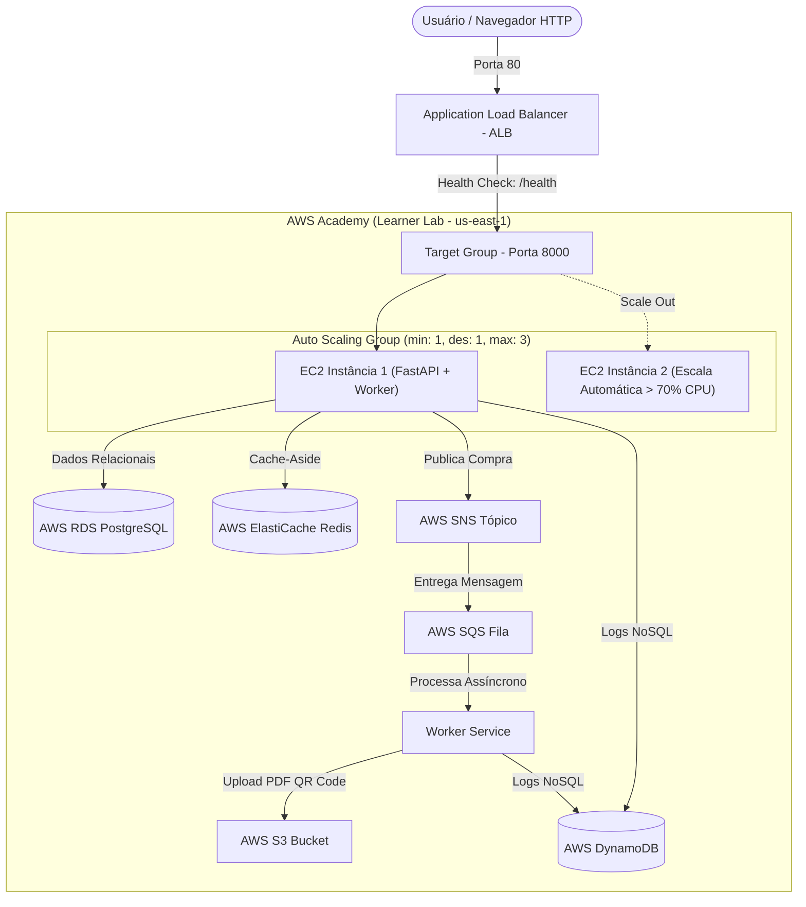

# Ticketz - Backend de Venda e Emissão de Ingressos

Emulação local dos serviços da AWS (S3, DynamoDB, SNS, SQS) via MiniStack, juntamente com PostgreSQL e Redis via Docker Compose, permitindo desenvolver e testar toda a arquitetura sem custos na nuvem. O Terraform roda em container e provisiona a infraestrutura emulada.

## Estrutura do Projeto

```
├── docker-compose.yml
├── .env.example
├── pyproject.toml
├── alembic.ini
├── migrations/          # Migrações do banco de dados relacional (Alembic)
├── infra/               # Infraestrutura como código Terraform (S3, SNS/SQS, DynamoDB)
├── src/
│   ├── main.py          # Ponto de entrada da API FastAPI
│   ├── core/            # Configurações, banco, cache, AWS e models
│   ├── auth/            # Módulo de autenticação JWT e controle de acesso
│   ├── evento/          # Gestão de eventos, vitrine e upload de banners
│   ├── ingresso/        # Compra atômica, listagem e download de ingressos
│   └── health.py        # Health check (/health/live e /health/ready)
├── worker/
│   ├── __main__.py      # Loop de consumo SQS, retry, DLQ e reconciliação
│   ├── handler.py       # Lógica de processamento e atualização de status
│   └── pdf.py           # Geração do PDF em memória com QR Code
└── tests/               # Suíte completa de testes automatizados
```

## Pré-requisitos

- Python 3.12+ e [uv](https://github.com/astral-sh/uv)
- Docker e Docker Compose

---

## Subindo o Ambiente (Passo a Passo)

### 1. Configurar Variáveis de Ambiente
Copie o arquivo de exemplo para criar o seu `.env`:
```bash
cp .env.example .env
```
O `.env.example` já vem pré-configurado para o ambiente local (conectando em `localhost:5432` para Postgres, `localhost:6379` para Redis e `localhost:4566` para MiniStack).

### 2. Subir os Serviços Básicos no Docker
Inicie os containers do emulador AWS (MiniStack), do banco relacional (PostgreSQL) e do cache (Redis):
```bash
docker compose up -d ministack postgres redis
```

Verifique se todos os containers estão saudáveis (`healthy`):
```bash
docker compose ps
```

### 3. Executar as Migrações do Banco de Dados (Alembic)
Com o PostgreSQL rodando, crie as tabelas no banco de dados (`usuarios`, `eventos`, `ingressos`):
```bash
uv run alembic upgrade head
```

### 4. Provisionar os Recursos AWS com Terraform
O container do Terraform conecta ao MiniStack e provisiona os buckets S3, o tópico SNS, a fila SQS com DLQ e a tabela do DynamoDB:

```bash
docker compose run --rm terraform init
docker compose run --rm terraform plan
docker compose run --rm terraform apply -auto-approve
```

Para conferir os recursos criados e os identificadores:
```bash
docker compose run --rm terraform output
```

Os outputs esperados são:
- `s3_bucket`: `ticketz-files-local`
- `sns_topic_arn`: `arn:aws:sns:us-east-1:000000000000:ticketz-ticket-purchased`
- `sqs_queue_url`: `http://localhost:4566/000000000000/ticketz-ticket-processing`
- `sqs_dlq_url`: `http://localhost:4566/000000000000/ticketz-ticket-processing-dlq`
- `dynamodb_table`: `ticketz-action-logs`

### 5. Subir a Aplicação

Em terminais separados:

#### Terminal 1: API (FastAPI / Uvicorn)
```bash
uv run uvicorn src.main:app --reload
```
A API estará disponível em `http://localhost:8000` e a documentação interativa em `http://localhost:8000/docs`.

#### Terminal 2: Worker Assíncrono
O worker consome mensagens da fila SQS com long polling (20s), gera o PDF com QR Code, faz o upload para o S3 e marca o ingresso como `READY`:
```bash
uv run python -m worker
```

#### Terminal 3: Frontend

```bash
cd frontend
npm install
npm run dev
```

O frontend local usa `http://localhost:8000` por meio de `VITE_API_URL`. A
origem `http://localhost:5173` já está autorizada por padrão no backend.

---

## Executando os Testes Automatizados

O projeto possui cobertura completa de testes unitários e de integração (autenticação, eventos, ingressos, serviços AWS e worker):
```bash
uv run pytest -v
```

Os testes do frontend ficam em `frontend/`:

```bash
cd frontend
npm run test:all
npm run lint
npm run build
```

---

## Deploy e Replicação na Nuvem (AWS Academy Learner Lab)

Esta seção detalha o fluxo completo para replicar a infraestrutura de produção e escalabilidade horizontal do **Ticketz** no **AWS Academy Learner Lab**, atendendo integralmente a todos os requisitos da disciplina de Desenvolvimento para Nuvem.

### Arquitetura em Nuvem

| Componente | Serviço AWS | Papel na Solução |
| :--- | :--- | :--- |
| **Interface Web & API** | **FastAPI no EC2 (ASG)** | Serve a SPA React (`frontend/dist`) e os endpoints REST na mesma origem (porta 8000). |
| **Balanceador de Carga** | **Application Load Balancer (ALB)** | Ponto único de entrada público na porta HTTP 80, balanceando entre instâncias EC2 do cluster. |
| **Elasticidade Horizontal** | **Auto Scaling Group (ASG)** | Mantém 1 instância inicial (`t3.micro`), escalando automaticamente para 2 ou até 3 instâncias quando a CPU média exceder 70% por 1 minuto. |
| **Banco Relacional** | **AWS RDS PostgreSQL 16** | Armazena usuários, eventos e ingressos de forma transacional (ACID). |
| **Cache em Memória** | **AWS ElastiCache Redis 7.1** | Cache-aside de vitrine e catálogo, contadores de hits/misses e aceleração de leituras. |
| **Armazenamento de Binários** | **AWS S3** | Armazenamento de banners de eventos e ingressos gerados em PDF. |
| **Fila e Tópico Assíncronos** | **AWS SNS + SQS + DLQ** | Desacoplamento da compra de ingressos: a API confirma a reserva e o worker processa assincronamente via fila. |
| **Logs de Auditoria** | **AWS DynamoDB** | Tabela NoSQL com capacidade sob demanda registrando todas as ações de criação, alteração e compra. |
| **Permissões e Segurança** | **IAM LabRole & LabInstanceProfile** | Atribuição de permissões sem credenciais fixas no código via IMDSv2. |



---

### Regras Críticas do AWS Academy Learner Lab

> [!IMPORTANT]
> 1. **IAM Restrito**: O laboratório bloqueia `iam:CreateRole` e `iam:CreatePolicy`. Não declare recursos IAM no Terraform; utilize exclusivamente a role `LabRole` e o perfil de instância `LabInstanceProfile`.
> 2. **Sessão Temporária (4 horas)**: As credenciais do painel *AWS Details* expiram a cada 4 horas e exigem sempre `AWS_SESSION_TOKEN`.
> 3. **Teto de Gastos ($100)**: A infraestrutura utiliza a **Default VPC** com IPs públicos nas instâncias EC2, dispensando NAT Gateways caros (~$32/mês cada).
> 4. **Single-Origin sem CloudFront**: O frontend compilado é servido diretamente pelas instâncias FastAPI sob o ALB na porta 80. Isso atende ao Requisito 1 (*interface executada em instância EC2*), elimina problemas de *Mixed Content* (HTTP/HTTPS) e dispensa certificados SSL/ACM ou domínios próprios.

---

### Roteiro de Replicação Passo a Passo

#### Passo 1: Pré-compilação do Frontend SPA (Mesma Origem)
No seu computador local, certifique-se de compilar o frontend com a API configurada para a mesma origem:
```bash
cd frontend
# Garanta que VITE_API_URL esteja vazio em .env para usar mesma origem dinamicamente
npm install
npm run build
cd ..
```
Os arquivos gerados estarão prontos em `frontend/dist`.

---

#### Passo 2: Construção da Golden AMI

A Golden AMI garante que todas as instâncias do cluster nasçam em segundos com Python 3.12, ferramentas de build, `uv`, código-fonte da aplicação, frontend compilado e unidades do Systemd devidamente habilitadas.

1. **Lançar Instância Temporária (Builder)**:
   No console EC2 da AWS ou via AWS CLI, lance uma máquina Ubuntu 24.04 (`t3.micro`) com SSH liberado e perfil `LabInstanceProfile`:
   ```bash
   aws ec2 run-instances \
     --image-id resolve:ssm:/aws/service/canonical/ubuntu/server/24.04/stable/current/amd64/hvm/ebs-gp3/ami-id \
     --instance-type t3.micro \
     --key-name vockey \
     --iam-instance-profile Name=LabInstanceProfile \
     --tag-specifications 'ResourceType=instance,Tags=[{Key=Name,Value=ticketz-ami-builder}]'
   ```

2. **Copiar o Repositório e Executar o Setup**:
   Transfira o projeto da sua máquina (incluindo `frontend/dist`) para a máquina temporária e execute o script automatizado:
   ```bash
   # Copia os arquivos
   scp -i ~/.ssh/vockey.pem -r . ubuntu@<IP_PUBLICO_BUILDER>:/tmp/ticketz

   # Conecta e roda o provisionamento
   ssh -i ~/.ssh/vockey.pem ubuntu@<IP_PUBLICO_BUILDER>
   bash /tmp/ticketz/scripts/setup_ami.sh
   exit
   ```

3. **Gerar a AMI e Terminar a Máquina Builder**:
   No terminal local:
   ```bash
   # Dispara a criação da imagem
   AMI_ID=$(aws ec2 create-image \
     --instance-id <ID_INSTANCIA_BUILDER> \
     --name "ticketz-golden-ami-$(date +%s)" \
     --description "Ticketz com FastAPI, Worker e Frontend embutidos" \
     --no-reboot \
     --query "ImageId" --output text)

   echo "AMI sendo gerada: $AMI_ID"

   # Aguarda a AMI ficar pronta (status: available)
   aws ec2 wait image-available --image-ids $AMI_ID

   # Finaliza a instância temporária para economizar créditos
   aws ec2 terminate-instances --instance-ids <ID_INSTANCIA_BUILDER>
   ```

---

#### Passo 3: Provisionamento da Infraestrutura com Terraform

1. **Exportar Credenciais do Learner Lab**:
   No painel do laboratório, clique em **AWS Details** e copie os valores:
   ```bash
   export AWS_ACCESS_KEY_ID="ASI..."
   export AWS_SECRET_ACCESS_KEY="..."
   export AWS_SESSION_TOKEN="..."
   export AWS_DEFAULT_REGION="us-east-1"
   export AWS_REGION="us-east-1"
   unset AWS_PROFILE
   unset AWS_ENDPOINT_URL
   ```

2. **Aplicar a Infraestrutura**:
   ```bash
   cd infra/aws
   terraform init
   terraform apply -var="ami_id=$AMI_ID" -auto-approve
   ```
   *(O provisionamento do RDS e ElastiCache leva entre 5 a 8 minutos).*

3. **Verificar os Outputs Gerados**:
   ```bash
   terraform output
   ```
   Anote principalmente a URL da API / plataforma:
   ```bash
   ALB_URL=$(terraform output -raw api_url)
   echo "Acesse a aplicação em: $ALB_URL"
   ```

---

#### Passo 4: Inicialização Automática (User Data e Systemd)

Quando o Auto Scaling Group inicia a instância EC2:
1. O script `user_data.sh.tftpl` cria o arquivo `/opt/ticketz/.env` preenchendo automaticamente as credenciais reais do RDS, Redis, S3, DynamoDB, SNS e SQS.
2. Executa as migrações do banco com `alembic upgrade head`.
3. Inicia e ativa os serviços no Systemd:
   - `ticketz-api.service`: Uvicorn rodando FastAPI na porta interna 8000.
   - `ticketz-worker.service`: Worker assíncrono consumindo SQS e gerando PDFs.
4. O Target Group do Load Balancer faz a checagem no endpoint `/health`. Em cerca de 2 minutos, o status passa para `healthy`:
   ```bash
   aws elbv2 describe-target-health \
     --target-group-arn $(terraform output -raw target_group_arn) \
     --query "TargetHealthDescriptions[*].{Target:Target.Id,State:TargetHealth.State}" \
     --output table
   ```

---

#### Passo 5: Acesso à Plataforma e Validação End-to-End

Todas as funcionalidades podem ser validadas diretamente pelo navegador ou via terminal utilizando o DNS do ALB:

1. **Interface Web (Frontend)**:
   Abra no seu navegador:
   ```
   http://<ALB_DNS_NAME>/
   ```
   A interface React do Ticketz carregará instantaneamente com catálogo de eventos, login, cadastro de organizador e painel de ingressos.

2. **Documentação Swagger Interativa**:
   ```
   http://<ALB_DNS_NAME>/docs
   ```

3. **Health Check e Conectividade dos Serviços**:
   ```bash
   # Liveness check do ALB
   curl "$ALB_URL/health"
   # Retorno esperado: {"status":"ok"}

   # Readiness check (valida conectividade com RDS, Redis e DynamoDB)
   curl "$ALB_URL/health/ready"
   # Retorno esperado: {"status":"ready","rds":"ok","redis":"ok","dynamodb":"ok"}
   ```

4. **Teste do Fluxo Completo de Ingressos**:
   - Cadastre um usuário e faça login na interface web (ou via API em `POST /auth/signup` e `POST /auth/token`).
   - Crie um evento com lotes de ingresso.
   - Compre um ingresso:
     1. A requisição atinge o **ALB** e chega à instância EC2.
     2. A API salva o registro no **RDS PostgreSQL** como `PENDING`.
     3. A API publica o evento no tópico **AWS SNS**.
     4. O SNS encaminha para a fila **AWS SQS**.
     5. O serviço `ticketz-worker` consome a mensagem da fila, desenha o PDF com QR Code, salva o arquivo no **AWS S3**, registra o log de auditoria no **AWS DynamoDB** e atualiza o ingresso no banco para `READY`.
     6. O usuário pode baixar o PDF diretamente pela interface.

5. **Métricas de Cache Redis**:
   ```bash
   curl "$ALB_URL/cache/stats"
   # Retorna estatísticas de hit rate e leituras aceleradas em memória
   ```

---

#### Passo 6: Teste de Carga com Locust (Auto Scaling e Load Balancing na Prática)

Esta etapa valida os **Requisitos (b), (c) e (d) da Parte 2**:
- **Requisito (b)**: O balanceador de carga (ALB) distribui o tráfego uniformemente entre as instâncias disponíveis do cluster.
- **Requisito (c) - Scale Out**: Quando a utilização média de CPU exceder **70% por mais de 1 minuto** (`period = 60s`, `evaluation_periods = 1`), o CloudWatch aciona a política do Auto Scaling Group para adicionar +1 instância (subindo de 1 para 2 máquinas, até o teto de 3).
- **Requisito (d) - Scale In**: Quando a carga cessa e a CPU fica abaixo de **25% por mais de 1 minuto**, a política de scale in remove 1 instância, retornando suavemente para a capacidade mínima de 1 máquina.

##### 1. Terminal 1: Monitoramento em Tempo Real do Cluster
Na raiz do projeto, execute o script de monitoramento para acompanhar a capacidade do ASG, instâncias saudáveis no Load Balancer e status dos alarmes do CloudWatch:
```bash
ALB_TG=$(cd infra/aws && terraform output -raw target_group_arn)
ASG_NAME=$(cd infra/aws && terraform output -raw asg_name)

bash scripts/monitor_elasticidade.sh "$ASG_NAME" "$ALB_TG"
```

O script exibirá uma tabela atualizada automaticamente a cada 10 segundos:
```text
Hora     | Desired | Atual | Healthy | Alarme High (70%) | Alarme Low (25%)
---------+---------+-------+---------+-------------------+-----------------
21:45:10 | 1       | 1     | 1       | OK                | ALARM
```

##### 2. Terminal 2: Execução do Locust contra o Load Balancer
O arquivo `tests/load/locustfile.py` simula o comportamento real de múltiplos compradores navegando pela vitrine, consultando detalhes (cache Redis) e tentando comprar ingressos (transação concorrente no RDS e mensageria SNS/SQS):

- **Opção A — Modo Interface Gráfica Web (Recomendado para demonstração e gravação)**:
  ```bash
  ALB_URL=$(cd infra/aws && terraform output -raw api_url)
  uv run locust -f tests/load/locustfile.py --host "$ALB_URL"
  ```
  Abra no seu navegador `http://localhost:8089`:
  - **Number of users**: `250`
  - **Spawn rate**: `25`
  - **Host**: `$ALB_URL` (já preenchido)
  - Clique em **Start swarming**.

- **Opção B — Modo Automatizado Headless (Terminal)**:
  O `locustfile.py` possui um perfil calibrado de carga (`AutoScalingShape`) que sobe automaticamente para 250 usuários mantendo a CPU acima de 70% por vários minutos e depois cessa:
  ```bash
  ALB_URL=$(cd infra/aws && terraform output -raw api_url)
  uv run locust -f tests/load/locustfile.py --host "$ALB_URL" --headless
  ```

##### 3. O que observar durante o teste (Ciclo de Vida da Elasticidade):

1. **Estado Inicial (Minuto 0)**:
   - Apenas 1 instância ativa no ASG (`Desired = 1`, `Atual = 1`).
   - O Target Group do ALB possui 1 instância com status `healthy`.
   - O alarme `ticketz-cpu-high-70` está em estado `OK`.

2. **Geração de Carga e Alarme CloudWatch (Minuto 1 a 2)**:
   - Os usuários do Locust realizam centenas de requisições por segundo.
   - O uso médio de CPU da máquina EC2 ultrapassa o limiar de 70%.
   - Após 60 segundos com CPU > 70%, o alarme `ticketz-cpu-high-70` muda para o estado `ALARM`.

3. **Scale Out e Registro no Load Balancer (Minuto 2 a 4)**:
   - A política `ticketz-asg-scale-out-cpu-high` é acionada e o ASG incrementa a capacidade para 2 instâncias (`Desired = 2`).
   - Uma nova máquina EC2 baseada na Golden AMI é inicializada automaticamente.
   - O script `user_data` conclui a configuração e os serviços sobem em instantes.
   - O Target Group do ALB detecta a nova instância e seu status passa para `healthy`.
   - **Load Balancing em Ação**: O ALB passa a dividir o tráfego HTTP entre as **2 instâncias ativas**, equilibrando o processamento e estabilizando a latência.

4. **Scale In após o término da carga (Minuto 5+)**:
   - Ao interromper o Locust (clicando em *Stop* na interface web ou cancelando o processo no terminal), a CPU média do conjunto cai para menos de 25%.
   - Após 60 segundos com CPU < 25%, o alarme `ticketz-cpu-low-25` entra em `ALARM`.
   - A política `ticketz-asg-scale-in-cpu-low` finaliza 1 instância (`scaling_adjustment = -1`), retornando o cluster para o piso de 1 máquina.

---

#### Passo 7: Descomissionamento e Limpeza dos Recursos

Ao término dos testes ou gravação da demonstração, destrua os recursos criados para não consumir créditos do laboratório:

```bash
cd infra/aws
terraform destroy -auto-approve
```
