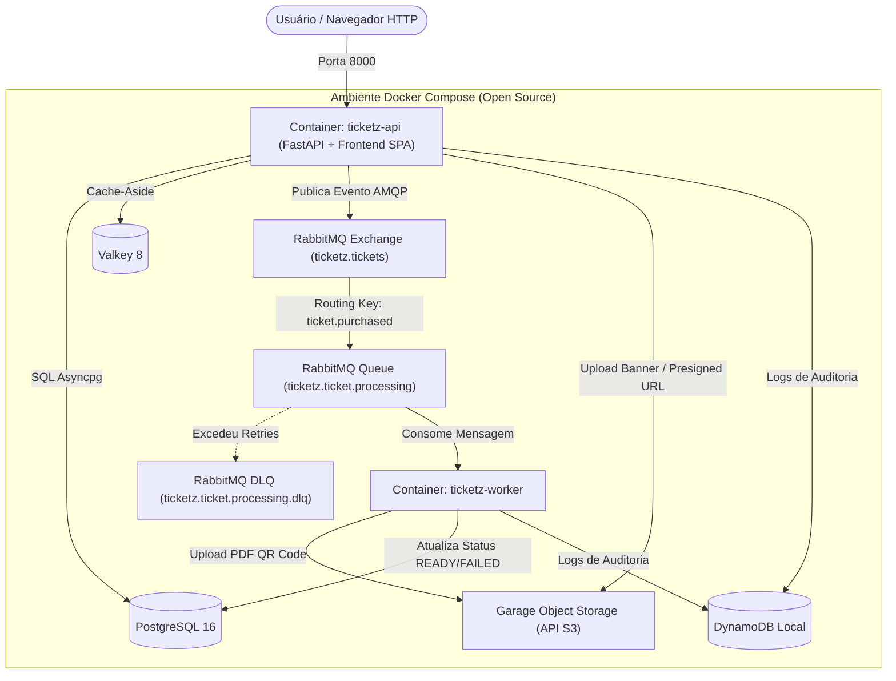

# Ticketz - Plataforma de Venda e Emissão de Ingressos (Open Source Stack)

Arquitetura completa de venda e emissão assíncrona de ingressos executando 100% via **Docker Compose** com ferramentas **Open Source** (**PostgreSQL**, **Valkey**, **RabbitMQ**, **Garage S3**) e **DynamoDB Local** para auditoria NoSQL.

## Arquitetura dos Serviços

| Componente | Tecnologia (Docker) | Papel na Solução | Porta Padrão |
| :--- | :--- | :--- | :--- |
| **Interface Web & API** | **FastAPI + React SPA (`ticketz-api`)** | Serve o frontend compilado (`frontend/dist`) e os endpoints REST na mesma origem. | `8000` |
| **Worker Assíncrono** | **Python Worker (`ticketz-worker`)** | Consome eventos de compra no RabbitMQ, gera PDF com QR Code, envia ao Garage e atualiza o status. | - |
| **Banco Relacional** | **PostgreSQL 16 (`postgres:16-alpine`)** | Persistência transacional (ACID) de usuários, eventos e ingressos com controle de concorrência. | `5432` |
| **Cache em Memória** | **Valkey 8 (`valkey/valkey:8-alpine`)** | Cache-aside da vitrine e detalhes de eventos, contadores de hits/misses e invalidação por versão. | `6379` |
| **Mensageria e Filas** | **RabbitMQ 4 (`rabbitmq:4-management-alpine`)** | Exchange `ticketz.tickets`, fila principal `ticketz.ticket.processing`, controle de retries e DLQ (`ticketz.ticket.processing.dlq`). | `5672` / `15672` (UI) |
| **Object Storage (S3)** | **Garage (`dxflrs/garage:v1.0.1`)** | Armazenamento de objetos compatível com a API S3 para banners de eventos e PDFs de ingressos. | `3900` (S3) / `3903` (Admin) |
| **Logs de Auditoria** | **DynamoDB Local (`amazon/dynamodb-local`)** | Banco NoSQL de documentos para trilha de auditoria (`ticketz-action-logs`), provisionado automaticamente na subida. | `8001` (`8000` interno) |



---

## Estrutura do Projeto

```
├── Dockerfile               # Multi-stage build (Frontend Node 22 + Backend/Worker Python 3.12)
├── docker-compose.yml       # Orquestração completa dos containers de infra e aplicação
├── docker/
│   └── garage/              # Configuração (garage.toml) e script de bootstrap (init.py) do Garage S3
├── .env.example             # Variáveis de ambiente padrão para execução local e via Docker
├── pyproject.toml           # Dependências Python gerenciadas pelo uv
├── alembic.ini              # Configuração do Alembic
├── migrations/              # Migrações do banco de dados relacional (PostgreSQL)
├── src/
│   ├── main.py              # Ponto de entrada da API FastAPI e entrega da SPA
│   ├── core/                # Configurações, banco, cache (Valkey), fila (RabbitMQ), S3 (Garage) e logs (DynamoDB)
│   ├── auth/                # Autenticação JWT e controle de acesso
│   ├── evento/              # Gestão de eventos, vitrine cacheada e upload de banners
│   ├── ingresso/            # Compra atômica, listagem, download via Presigned URL e reprocessamento
│   └── health.py            # Endpoints /health, /health/ready e /cache/stats
├── worker/
│   ├── __main__.py          # Loop de consumo RabbitMQ, retry com x-attempt, DLQ e reconciliação
│   ├── handler.py           # Processamento de ingresso, upload de PDF e atualização de status
│   └── pdf.py               # Geração do PDF em memória com QR Code
├── frontend/                # Aplicação React + TypeScript + Vite
└── tests/                   # Suíte de testes automatizados (Pytest + Locust)
```

---

## Subindo Tudo via Docker Compose (Modo Completo)

1. **Configurar variáveis de ambiente**:
   ```bash
   cp .env.example .env
   ```

2. **Construir e iniciar todos os containers**:
   ```bash
   docker compose up -d --build
   ```
   O Docker Compose irá:
   - Subir **PostgreSQL**, **Valkey**, **RabbitMQ**, **Garage** e **DynamoDB Local**;
   - Executar o container `garage-init` para configurar automaticamente o layout single-node do Garage, importar a chave S3 e criar o bucket `ticketz-files-local`;
   - Compilar o frontend React e construir a imagem da aplicação;
   - Executar `alembic upgrade head` e iniciar o **FastAPI (`ticketz-api`)** na porta `8000` e o **Worker (`ticketz-worker`)** em background.

3. **Acessar a plataforma**:
   - **Aplicação Web (Frontend + API)**: `http://localhost:8000`
   - **Documentação Swagger UI**: `http://localhost:8000/docs`
   - **Health & Readiness Check**: `http://localhost:8000/health/ready`
   - **Painel de Gerenciamento do RabbitMQ**: `http://localhost:15672` (usuário: `guest`, senha: `guest`)

---

## Desenvolvimento Local (Híbrido: Infra no Docker + Código no Host)

Caso queira rodar apenas os serviços de infraestrutura no Docker e executar a API/Worker/Frontend diretamente na máquina host:

1. **Subir apenas os serviços de infraestrutura**:
   ```bash
   docker compose up -d postgres valkey rabbitmq garage garage-init dynamodb
   ```

2. **Executar as migrações do banco relacional**:
   ```bash
   uv run alembic upgrade head
   ```

3. **Iniciar a API e o Worker em terminais separados**:
   ```bash
   # Terminal 1 - API
   uv run uvicorn src.main:app --reload

   # Terminal 2 - Worker
   uv run python -m worker

   # Terminal 3 - Frontend em modo dev (opcional)
   cd frontend && npm install && npm run dev
   ```

---

## Executando os Testes Automatizados

Com os containers de infraestrutura rodando (`postgres`, `valkey`, `rabbitmq`, `garage`, `dynamodb`), execute:

```bash
uv run pytest -v
```

Para os testes e verificações do frontend:

```bash
cd frontend
npm run lint
npm run test
npm run build
```
