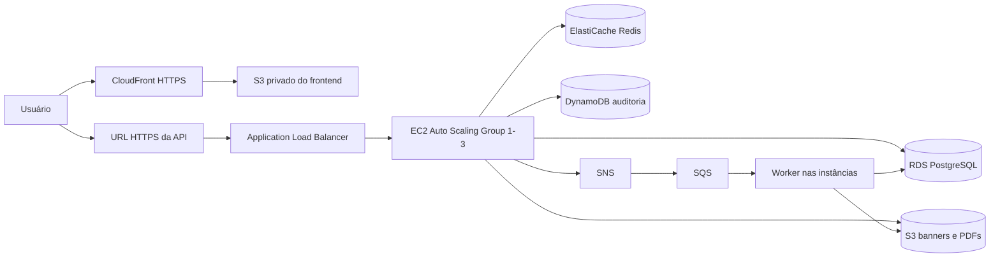

# Relatório de desenvolvimento do frontend — Ticketz

**Data de atualização:** 12 de outubro de 2026  
**Repositório:** `ticketz`  
**Frontend:** `ticketz/frontend`  
**Branch atual:** `docs/frontend-backend-guide`

## 1. Visão geral

O frontend do Ticketz foi implementado até a **Etapa 10** do plano, e a preparação versionada da **Etapa 11** está concluída. A aplicação já possui a base React, o cliente HTTP centralizado, autenticação, vitrine pública de eventos, paginação, diagnóstico de cache, compra, a área completa de ingressos, o painel do organizador, os logs de auditoria, a revisão transversal de acessibilidade e responsividade e uma suíte consolidada de testes unitários, de componentes e ponta a ponta. Depois dessas etapas, a interface recebeu ainda uma revisão de linguagem para apresentar o Ticketz como produto, sem expor nomes de serviços AWS ou detalhes acadêmicos ao usuário final.

A **Etapa 11 está em andamento**. Build seguro, CORS configurável, infraestrutura e automação de deploy estão preparados; a criação dos recursos e a validação pública dependem da sessão AWS Academy e do DNS HTTPS real do ALB.

| Etapa | Assunto | Situação |
|---|---|---|
| 1 | Fundação do frontend | Concluída |
| 2 | Cliente HTTP e tratamento de erros | Concluída |
| 3 | Autenticação, sessão e proteção de rotas | Concluída |
| 4 | Vitrine de eventos, paginação e cache | Concluída |
| 5 | Detalhes do evento e compra | Concluída |
| 6 | Meus ingressos, polling, download e reprocessamento | Concluída |
| 7 | Painel do organizador | Concluída |
| 8 | Logs de auditoria | Concluída |
| 9 | Revisão de acessibilidade e responsividade | Concluída |
| 10 | Ampliação e consolidação dos testes | Concluída |
| 11 | Build e publicação na AWS | Em andamento |
| Refinamento adicional | Linguagem de produto na interface | Concluído |

## 2. Stack e decisões gerais já aplicadas

O frontend utiliza a stack definida pelo plano:

- React 19 com TypeScript e Vite;
- React Router para navegação;
- TanStack Query para cache, invalidação e estado das requisições;
- React Hook Form e Zod para formulários e validações;
- CSS Modules para estilos locais;
- Vitest e Testing Library para testes automatizados;
- Lucide React para ícones acessíveis e consistentes.

Também foram aplicadas estas regras gerais:

- toda comunicação HTTP passa pelo cliente central em `src/api/client.ts`;
- a URL do backend vem de `VITE_API_URL`, sem URL fixa no código;
- o token JWT fica no `sessionStorage`;
- formulários e mensagens da interface estão em português do Brasil;
- nomes de arquivos, funções, tipos e variáveis permanecem em inglês;
- estados relevantes usam texto e ícone, sem depender somente de cor;
- páginas implementadas possuem estados de carregamento, erro, vazio ou sucesso conforme aplicável;
- o layout foi construído com abordagem mobile-first;
- o backend continua sendo a autoridade para autenticação, autorização e regras de negócio.

## 3. Etapas concluídas

### Etapa 1 — Fundação do frontend

**Branch:** `chore/front-foundation`  
**Commits:**

- `6eae40a` — `chore: configura base do frontend`
- `69dc806` — `feat: cria layout e rotas iniciais`

#### O que foi implementado

- Criação do projeto React + TypeScript + Vite dentro de `ticketz/frontend`.
- Instalação e configuração das dependências principais definidas no plano.
- Arquivo `.env.example` com:
  - `VITE_API_URL` para o endereço do backend;
  - `VITE_SHOW_CACHE_DEBUG` para habilitar o diagnóstico visual de cache.
- Configuração do `QueryClient` e do provedor do TanStack Query.
- Configuração inicial do React Router.
- Estrutura base de pastas para páginas, componentes, API, contexto, tipos e utilitários.
- Layout principal com cabeçalho, navegação, conteúdo e rodapé.
- Tema visual, estilos globais, foco visível e fundação responsiva.
- Página de rota não encontrada.
- Páginas provisórias para permitir navegar pelas rotas antes da implementação de cada funcionalidade.
- Imagem SVG de fallback para eventos sem banner disponível.

#### Rotas preparadas

- `/`
- `/eventos/:id`
- `/login`
- `/cadastro`
- `/meus-ingressos`
- `/meus-ingressos/:id`
- rotas reservadas para o painel do organizador;
- rota curinga para páginas inexistentes.

#### Relação com a AWS

A fundação já separa o endereço da API por variável de ambiente. Em produção, `VITE_API_URL` poderá apontar para o DNS HTTPS do Application Load Balancer, sem depender do endereço de uma instância EC2 específica. O projeto Vite também produzirá os arquivos estáticos de `dist`, que serão usados posteriormente na publicação via S3 e CloudFront.

### Etapa 2 — Cliente HTTP e tratamento de erros

**Branch:** `feat/front-http-client`  
**Commits:**

- `090126d` — `feat: implementa cliente HTTP central`
- `87747a2` — `feat: padroniza mensagens de erro da API`

#### O que foi implementado

- Cliente HTTP centralizado em `src/api/client.ts`.
- Leitura obrigatória da URL base por `VITE_API_URL`.
- Remoção segura da barra final da URL base.
- Inclusão automática do JWT no cabeçalho `Authorization: Bearer ...` quando existe uma sessão.
- Serialização automática de corpos JSON.
- Envio de `FormData` sem definir manualmente o `Content-Type`, permitindo ao navegador gerar corretamente o `boundary` do multipart.
- Suporte a `AbortSignal` para cancelamento de requisições.
- Tratamento correto de respostas HTTP `204 No Content`, sem tentar interpretar JSON inexistente.
- Leitura do cabeçalho `X-Cache`, incluindo os estados `HIT` e `MISS`.
- Classe `ApiError` preservando:
  - o status HTTP;
  - o campo `detail` quando for uma string;
  - o campo `detail` quando for um objeto estruturado.
- Utilitário de mensagens para traduzir erros da API em mensagens da interface.
- Tratamento das mensagens previstas para erros como `401`, `403`, `404`, `413`, `415`, `422`, `500` e `503`.
- Tratamento de códigos de negócio e de erros associados a campos de formulários.

#### Relação com a AWS

O cliente está preparado para consumir a API por meio de um ALB e enviar o token no cabeçalho `Authorization`. A leitura de `X-Cache` torna demonstrável a utilização do cache Redis pelo backend. O cuidado com `FormData` será necessário para o upload de banners que serão armazenados no S3.

### Etapa 3 — Autenticação, sessão e proteção de rotas

**Branch:** `feat/front-auth`  
**Commits:**

- `b11007e` — `feat: implementa sessão de autenticação`
- `b0994ca` — `feat: cria formulários de cadastro e login`
- `5de82ab` — `feat: protege rotas por autenticação e papel`

#### O que foi implementado

- Tipos TypeScript relacionados a usuário, autenticação e papéis.
- Integração com os endpoints de cadastro, login e consulta da sessão atual.
- `AuthProvider` e hook `useAuth` para disponibilizar a sessão na aplicação.
- Persistência do JWT no `sessionStorage`.
- Restauração da sessão com consulta a `/auth/me` ao recarregar a página.
- Encerramento automático da sessão quando a API responde `401` por token inválido ou expirado.
- Limpeza das queries privadas do TanStack Query durante o logout.
- Formulário de login com React Hook Form e Zod.
- Formulário de cadastro com escolha entre usuário e organizador.
- Labels associados aos campos, mensagens de validação e retorno acessível de sucesso ou erro.
- Redirecionamento para a rota originalmente solicitada após o login.
- Guarda para rotas autenticadas.
- Guarda específica para rotas de organizador.
- Página de acesso negado para casos de autorização insuficiente.
- Navegação dinâmica de acordo com o estado de autenticação e o papel do usuário.
- Ação de logout no cabeçalho.

#### Relação com a AWS

O JWT é enviado ao backend por meio do ALB em todas as chamadas autenticadas. Isso exige que o CORS aceite o cabeçalho `Authorization`. O frontend apenas adapta a navegação ao papel conhecido; a autorização efetiva continua sendo validada pela API executada na infraestrutura AWS.

### Etapa 4 — Vitrine de eventos, paginação e diagnóstico de cache

**Branch:** `feat/front-event-showcase`  
**Commits:**

- `f9e34ef` — `feat: integra catálogo público de eventos`
- `309fcfb` — `feat: cria vitrine responsiva de eventos`
- `852cec9` — `feat: adiciona paginação e diagnóstico de cache`

#### O que foi implementado

- Tipos para eventos, ingressos e informações de cache.
- Integração com `GET /eventos`, incluindo os parâmetros `limit` e `offset`.
- Integração com o endpoint de estatísticas de cache previsto pelo plano.
- Substituição da página inicial provisória pela vitrine real de eventos.
- Componentes de cartão e grade de eventos.
- Skeleton durante o carregamento.
- Estado vazio quando não há eventos.
- Estado de erro com opção de tentar novamente.
- Exibição do banner temporário do evento e fallback quando a imagem não carrega.
- Datas formatadas em português do Brasil com o fuso `America/Fortaleza`.
- Quantidade de ingressos disponíveis.
- Identificação de evento esgotado com texto, ícone e cor.
- Link para a página de detalhes de cada evento.
- Paginação de 12 eventos por página.
- Cálculo do `offset` a partir da página selecionada.
- Manutenção dos dados anteriores durante a troca de página para evitar saltos bruscos.
- Indicador opcional de diagnóstico de cache, habilitado somente quando `VITE_SHOW_CACHE_DEBUG=true`.
- Exibição de `X-Cache: HIT` ou `MISS` e métricas disponíveis para a demonstração.

#### Relação com a AWS

Esta etapa torna o cache Redis visível na demonstração. Ao habilitar `VITE_SHOW_CACHE_DEBUG`, é possível repetir a consulta e observar a mudança entre `MISS` e `HIT`, conforme o comportamento do backend. Os banners são tratados como URLs temporárias do S3 e possuem fallback caso expirem ou falhem.

### Etapa 5 — Detalhes do evento e compra

**Branch:** `feat/front-event-details-purchase`  
**Commits:**

- `bd89d08` — `fix: expõe cabeçalho de cache no CORS`
- `40ae647` — `feat: integra detalhe e compra de ingresso`
- `b4fa2d0` — `feat: implementa detalhe e compra de evento`

#### O que foi implementado no frontend

- Centralização das chaves de cache usadas pelo TanStack Query.
- Integração com `GET /eventos/{id}`.
- Integração com a operação de compra definida pelo contrato, sem inventar corpo adicional para a requisição.
- Ampliação dos tipos de ingresso para representar a resposta completa da compra.
- Página de detalhes contendo:
  - banner do evento e fallback;
  - descrição;
  - data e horário;
  - local;
  - quantidade total e quantidade disponível;
  - indicação clara de evento esgotado.
- Para visitante sem sessão, o botão de compra leva ao login e preserva a rota de retorno.
- Quando já existe ingresso do usuário para o evento, a interface direciona para o ingresso existente.
- Diálogo acessível de confirmação de compra com:
  - foco inicial controlado;
  - navegação por teclado;
  - contenção de foco;
  - fechamento pela tecla `Escape`.
- Bloqueio de cliques repetidos enquanto a compra está em andamento.
- Mensagens específicas para conflitos de ingresso duplicado, evento encerrado ou evento esgotado.
- Após uma compra com sucesso:
  - o ingresso retornado é inserido no cache de detalhes;
  - o catálogo e o detalhe do evento são invalidados;
  - a lista de ingressos é invalidada;
  - o usuário é redirecionado para `/meus-ingressos/{id}`;
  - a interface informa que o ingresso foi criado e pode estar em processamento.
- Página transitória de detalhes do ingresso com aviso de sucesso e status `PENDING`.
- O diagnóstico de cache também pode exibir o `X-Cache` da consulta de detalhes.

#### Ajuste de CORS realizado

Apesar de o trabalho estar concentrado no frontend, esta etapa incluiu uma exceção pequena e explícita no backend porque foi solicitado corrigir o CORS:

- `src/main.py` passou a expor o cabeçalho `X-Cache` ao navegador;
- `tests/test_cors.py` recebeu a verificação da configuração do middleware;
- a política de origens ainda usa `*` e deverá ser restringida ao domínio real do frontend antes da produção.

Sem `Access-Control-Expose-Headers: X-Cache`, o navegador recebe a resposta, mas o JavaScript não consegue ler esse cabeçalho. O ajuste permite que o indicador de cache funcione durante a demonstração.

#### Relação com a AWS

A compra foi preparada para o fluxo assíncrono da arquitetura: uma resposta `201` pode trazer o ingresso como `PENDING`, e esse estado não é tratado como erro. O processamento posterior por SNS/SQS e worker passou a ser acompanhado pelo polling implementado na Etapa 6. As invalidações de consultas também garantem que alterações de estoque e cache sejam consultadas novamente após a compra.

### Etapa 6 — Meus ingressos, polling, download e reprocessamento

**Branch:** `feat/front-my-tickets`  
**Commits:**

- `a2f07cb` — `feat: integra area de ingressos`
- `3a07c2d` — `feat: implementa lista de ingressos`
- `b687341` — `feat: implementa acompanhamento do ingresso`

#### O que foi implementado

- Integração com a lista autenticada de ingressos em `GET /ingressos`.
- Paginação de 10 itens com manutenção dos dados anteriores durante a troca de página.
- Cards contendo evento, data, local, data da compra, status e acesso ao detalhe.
- Estados de carregamento, erro e lista vazia.
- Integração do detalhe real em `GET /ingressos/{id}`.
- Mensagem neutra e única para ingresso inexistente ou pertencente a outra pessoa.
- Representação de `PENDING`, `READY` e `FAILED` com texto, ícone e cor.
- Polling do detalhe a cada 2,5 segundos somente enquanto o ingresso está `PENDING`.
- Interrupção automática do polling ao chegar em `READY` ou `FAILED`.
- Pausa do polling depois de dois minutos, preservando o estado `PENDING` e oferecendo atualização manual.
- Atualização da lista em cache quando o processamento termina.
- Download disponível somente para `READY`, solicitando uma URL temporária em `GET /ingressos/{id}/download` e usando-a imediatamente sem persistência.
- Nova URL solicitada a cada clique de download, respeitando a expiração de 300 segundos definida pelo backend.
- Reprocessamento disponível somente para `FAILED` por `POST /ingressos/{id}/reprocessar`.
- Tratamento da resposta assíncrona `202`, atualização imediata para `PENDING`, reinício do polling e invalidação das queries de detalhe e lista.
- Bloqueio de downloads e reprocessamentos repetidos enquanto a requisição está em andamento.
- Aviso dinâmico acessível para mudanças de status.
- Layout responsivo para lista e detalhe.

#### Relação com a AWS

Esta etapa torna visível o processamento assíncrono por SNS/SQS e worker: a interface acompanha a transição do ingresso sem bloquear a compra. Também demonstra o acesso seguro ao PDF armazenado no S3 por uma URL temporária que não é salva no navegador.

### Etapa 7 — Painel do organizador

**Branch:** `feat/front-organizer-panel`  
**Commits:**

- `1fd19f5` — `feat: integra gestao de eventos`
- `4f12559` — `feat: implementa formularios de eventos`
- `fb1704f` — `feat: implementa painel do organizador`

#### O que foi implementado

- Integração com `GET /eventos/meus`, usando paginação de 20 itens.
- Painel com banner, nome, data, local, ingressos disponíveis/total e atalhos para editar, consultar logs e desativar.
- Estados de carregamento, erro e painel vazio.
- Formulário reutilizável de criação e edição com React Hook Form e Zod.
- Validação de nome, local, data futura e total inteiro maior que zero.
- Conversão de `datetime-local` para ISO por `new Date(value).toISOString()`.
- Conversão do ISO recebido para o valor local correto na edição.
- Criação por `POST /eventos`, com o banner enviado somente depois da criação.
- Preservação do evento criado quando o upload do banner falha, seguida de redirecionamento para uma nova tentativa na edição.
- Edição parcial enviando somente os campos permitidos que foram alterados.
- Campo `total_ingressos` somente para leitura na edição, acompanhado de explicação.
- Garantia de que a edição não envia `total_ingressos`, `ingressos_disponiveis`, `organizador_id`, `ativo`, `id` ou datas de auditoria.
- Validação do banner no cliente para JPEG, PNG e WebP com até 5 MiB.
- Preview local do banner, com liberação da URL de objeto ao substituir ou desmontar o componente.
- Upload multipart usando exatamente o campo `arquivo`, sem definir manualmente o `Content-Type`.
- Confirmação acessível antes da desativação, explicando a saída da vitrine e a preservação dos ingressos emitidos.
- Remoção imediata do item do painel depois do `204` e invalidação dos caches de eventos após todas as mutações.
- Verificação adicional na tela de edição para impedir que o organizador edite pela interface um evento pertencente a outra conta.
- Layout responsivo para painel e formulários.

#### Relação com a AWS

O fluxo exercita operações autenticadas e autorizadas que passam pelo ALB. O banner é enviado como multipart para a API, armazenado no S3 e exibido por URL temporária, sem persistir esse endereço no navegador.

### Etapa 8 — Logs de auditoria

**Branch:** `feat/front-audit-logs`  
**Commits:**

- `d8fb1a2` — `feat: integra logs de auditoria`
- `27aa098` — `feat: implementa timeline de auditoria`

#### O que foi implementado

- Integração com `GET /eventos/{id}/logs`.
- Primeiro carregamento com `limit=20` e sem fabricar cursor.
- Paginação incremental usando exatamente o cursor devolvido pelo backend.
- Botão “Carregar mais” somente enquanto existe uma próxima página.
- Acréscimo dos registros antigos à timeline sem substituir os itens já exibidos.
- Eliminação defensiva de registros repetidos usando `entidade` e `sk`.
- Reinício automático da paginação sem cursor ao trocar o identificador do evento na rota.
- Linha do tempo ordenada conforme a resposta do backend, do registro mais recente para o mais antigo.
- Rótulos amigáveis para criação, consulta, edição, desativação e atualização de banner.
- Exibição de data/hora, usuário quando disponível, entidade e resumo dos dados relevantes.
- Comparação de `dados.antes` e `dados.depois` para mostrar somente os campos realmente alterados.
- Conversão dos nomes técnicos de campos para rótulos legíveis e formatação especial para datas e valores vazios.
- Seção expansível com o JSON técnico completo de cada registro.
- Estados de carregamento, vazio, erro inicial e erro ao buscar uma página adicional.
- Autorização mantida pelo endpoint do backend, que permite a consulta somente ao dono do evento.
- Layout responsivo da timeline, incluindo dados técnicos com rolagem controlada.

#### Relação com a AWS

A tela torna demonstráveis os registros de auditoria armazenados no DynamoDB. A paginação respeita o `LastEvaluatedKey` codificado pelo backend e não tenta convertê-lo em paginação por offset.

### Etapa 9 — Revisão de acessibilidade e responsividade

**Branch:** `feat/front-a11y-responsive`  
**Commits:**

- `5bb99aa` — `feat: aprimora acessibilidade e responsividade`
- `f7622cb` — `perf: divide bundle por rota`
- `55ee5c0` — `fix: refina foco do conteudo principal`

#### O que foi implementado

- Revisão transversal dos elementos semânticos, labels, nomes acessíveis e descrições de erro.
- Foco automático no primeiro campo inválido, incluindo erros de validação devolvidos pela API.
- Associação simultânea de ajuda e erro com `aria-describedby` quando ambas as mensagens existem.
- Grupo de perfil do cadastro com estado inválido e mensagem de erro identificada para tecnologias assistivas.
- Foco no conteúdo principal após mudanças de rota, preservando o link de salto para navegação por teclado.
- Diálogo de confirmação com IDs únicos, foco inicial na ação segura, ciclo de foco com Tab e Shift+Tab, fechamento por Escape e devolução do foco ao controle de origem.
- Estados de carregamento dos botões identificados com `aria-busy` e alertas dinâmicos com `aria-atomic`.
- Indicador de foco com contorno duplo para permanecer visível em fundos claros e escuros.
- Manutenção da preferência `prefers-reduced-motion` para animações e rolagem.
- Remoção da largura mínima global que poderia provocar rolagem horizontal e ajustes de botões, formulários, diálogo e espaçamento em telas estreitas.
- Verificação em 360 px da vitrine e do cadastro, sem rolagem horizontal, com formulário, navegação e mensagens de erro utilizáveis.
- Validação dos contrastes principais, com razões entre 5,80:1 e 16,69:1.
- Carregamento preguiçoso de todas as páginas por rota, com fallback acessível durante a transição.
- Redução do JavaScript inicial de aproximadamente 541 kB para 356 kB, eliminando o aviso de chunk acima de 500 kB.

#### Relação com a AWS

A etapa não depende diretamente de um serviço AWS. A divisão do bundle reduz o JavaScript inicial transferido pelo S3 e pelo CloudFront, melhorando o carregamento da aplicação publicada.

### Etapa 10 — Ampliação e consolidação dos testes

**Branch:** `test/front-tests`
**Commits:**

- `bfdbd50` — `test: amplia cobertura de componentes`
- `7a2c450` — `test: adiciona fluxos ponta a ponta`

#### O que foi implementado

- Ampliação da suíte Vitest para cobrir explicitamente os três estados de ingresso com texto e ícone.
- Teste específico da validação de data futura no formulário de evento.
- Teste garantindo que um ingresso inicialmente `READY` não inicia polling.
- Verificações de que download e reprocessamento aparecem somente nos estados permitidos.
- Separação entre a descoberta de testes do Vitest e os cenários Playwright.
- Configuração do Playwright com Chromium, servidor Vite isolado e scripts `test:e2e` e `test:all`.
- Cenário ponta a ponta do visitante: vitrine, paginação, detalhe do evento e redirecionamento ao login.
- Cenário ponta a ponta do usuário: cadastro, login, compra, transição de `PENDING` para `READY`, download por URL temporária e conflito de segunda compra.
- Cenário ponta a ponta do organizador: login, criação, envio multipart do banner, edição somente dos campos permitidos, consulta dos logs e desativação com remoção da vitrine.
- Cenário ponta a ponta de autorização: bloqueio do painel para usuário comum, bloqueio de evento pertencente a outro organizador e resposta neutra para ingresso alheio.
- Monitoramento dos cenários para detectar erros JavaScript não tratados no navegador.
- Respostas da API simuladas no navegador, mantendo os contratos HTTP, CORS, JWT, multipart, paginação, estados assíncronos e URLs temporárias sem depender dos serviços AWS reais.
- Execução do teste Python de CORS em ambiente temporário com as dependências do backend.

#### Relação com a AWS

Os testes representam os comportamentos originados pelo Redis, pelo processamento assíncrono com SNS/SQS, pelo armazenamento temporário no S3 e pela auditoria no DynamoDB. A simulação preserva os contratos de rede e permite validar o frontend sem manter a infraestrutura AWS ativa em cada execução.

## 4. Testes e verificações já realizados

No estado atual, incluindo as Etapas 10 e 11 e o refinamento de linguagem de produto, o frontend apresenta:

- **114 testes unitários e de componentes aprovados**, distribuídos em 19 arquivos de teste;
- **4 cenários ponta a ponta aprovados** no Chromium, em um arquivo Playwright;
- `npm run build` aprovado;
- `npm run lint` aprovado;
- testes específicos para paginação dos ingressos, polling e suas paradas, timeout local, download temporário, reprocessamento e estado neutro para `404`;
- testes específicos para integração da gestão de eventos, validação do formulário e banner, criação com e sem banner, falha parcial do upload, payload seguro de edição e desativação confirmada;
- testes específicos para cursor de auditoria, timeline, comparação antes/depois, carregamento incremental sem duplicatas, troca de evento, estado vazio e autorização;
- testes específicos para foco em mudanças de rota, primeiro erro de formulário e controle completo do foco no diálogo;
- verificação visual da vitrine, do cadastro e do login em larguras de celular, além da página inicial em desktop;
- ausência de rolagem horizontal nas telas verificadas;
- quatro fluxos críticos validados no navegador com respostas simuladas da API;
- ausência de erros JavaScript não tratados nos cenários ponta a ponta;
- teste Python específico de CORS aprovado, confirmando a exposição de `X-Cache`;
- build de produção gerado com sucesso após a implementação.

O build deixou de produzir o aviso de bundle acima de 500 kB depois da divisão de código por rota. O arquivo JavaScript inicial passou de aproximadamente 541 kB para 356 kB.

## 5. Etapa em andamento

### Etapa 11 — Build e publicação

**Branch:** `chore/front-deploy`
**Commits:**

- `96d1272` — `fix: restringe cors por ambiente`
- `ee4884c` — `infra: prepara hospedagem do frontend`
- `083371b` — `chore: automatiza build e deploy do frontend`
- `c6a32de` — `docs: documenta publicacao do frontend`

Itens concluídos no repositório:

- CORS restrito a origens HTTP(S) explícitas por variável de ambiente, sem aceitar `*`;
- preservação de `Authorization`, métodos da API e exposição de `X-Cache`;
- seis testes específicos de configuração e normalização do CORS;
- exemplo de ambiente de produção sem URL ou credencial real;
- build de produção que exige API HTTPS, rejeita endereços locais e verifica `dist`;
- script seguro de publicação com cache imutável para assets e invalidação do CloudFront;
- módulo Terraform independente do MiniStack para bucket S3 privado e exclusivo do frontend;
- CloudFront com HTTPS, Origin Access Control, compressão, cabeçalhos de segurança e fallback de SPA;
- versionamento, criptografia e bloqueio integral de acesso público no bucket;
- configuração validada com Terraform 1.10 e provider AWS 5.100.0;
- documentação de provisionamento, build, deploy e relação com a arquitetura obrigatória do trabalho.

Itens que dependem do ambiente AWS real:

- configurar `VITE_API_URL` com o DNS HTTPS real do ALB;
- configurar `CORS_ALLOWED_ORIGINS` com o domínio real do CloudFront;
- executar `terraform plan` e `terraform apply` com uma sessão AWS Academy válida;
- publicar o conteúdo de `frontend/dist` em um bucket S3;
- validar envio do cabeçalho `Authorization` em produção;
- validar exposição e leitura do `X-Cache`;
- verificar HTTPS e atualização direta das rotas na distribuição criada;
- registrar no relatório as URLs e os identificadores efetivamente provisionados;
- gravar o vídeo demonstrando o ALB e o Auto Scaling Group exigidos pela Parte 2.

**Relação com a AWS:** esta etapa conecta diretamente o frontend ao S3, CloudFront e ALB. O S3 hospedará o build estático, o CloudFront fará a distribuição HTTPS e o ALB encaminhará as chamadas da API para a aplicação.

### Refinamento adicional — linguagem de produto

**Branch:** `feat/front-product-copy`  
**Commit:**

- `9a8e32d` — `feat: apresenta interface com linguagem de produto`

#### O que foi implementado

- Remoção das menções visíveis a AWS, S3, SNS, SQS, Redis, DynamoDB, JWT, API e “projeto demonstrativo” nas telas destinadas ao usuário final.
- Manutenção integral da arquitetura e das integrações exigidas pelo trabalho; a alteração foi somente na comunicação e apresentação visual.
- Reescrita da seção institucional da página inicial para comunicar os benefícios de descoberta, compra e acesso ao ingresso.
- Substituição de ícones de infraestrutura por ícones associados à jornada do cliente, segurança e experiência.
- Troca do texto fictício “Festival na nuvem” por “Festival Aurora” no ingresso ilustrativo.
- Rodapé reescrito como mensagem de marca: “Bons momentos começam com o ingresso certo”.
- Avisos de login e cadastro reescritos para comunicar proteção de conta e dados, sem citar a implementação de autenticação.
- Textos de criação de evento, auditoria e estados do ingresso reescritos em linguagem orientada à tarefa.
- Diagnóstico opcional de cache mantido para a demonstração, mas apresentado como desempenho do catálogo e sem nomes de provedores na interface.
- Renomeação das classes internas associadas a “cloud” para nomes coerentes com experiência, confiança e marca.
- Atualização dos testes afetados pelos novos nomes acessíveis.
- Verificação visual em desktop e celular, incluindo confirmação de ausência de rolagem horizontal.

#### Validações do refinamento

- `npm run lint` aprovado;
- 114 testes unitários e de componentes aprovados;
- quatro cenários ponta a ponta aprovados;
- `npm run build` aprovado;
- revisão visual da página inicial e da tela de login em desktop e celular.

## 6. Pontos de atenção conhecidos

- O backend real ainda pode exigir ajustes. As integrações atuais seguem o contrato documentado no plano e não adicionam endpoints ou campos não especificados.
- O CORS expõe `X-Cache` e rejeita origem curinga; o domínio real do CloudFront ainda precisa ser configurado no ambiente de produção.
- O bundle inicial foi reduzido com divisão por rota; o tamanho deve continuar sendo acompanhado nas próximas funcionalidades.
- URLs temporárias de S3 não são guardadas no estado persistente ou no armazenamento do navegador e esse cuidado deve ser mantido nas próximas etapas.
- A existência de uma rota protegida no frontend não substitui autorização no backend.
- O arquivo `.env` real deve continuar fora do Git. Somente `.env.example` pode ser versionado.

## 7. Como executar e verificar o frontend localmente

No diretório raiz `CK0205-CLOUD`, execute:

```bash
cd ticketz/frontend
npm install
```

Se ainda não existir um `.env` local, copie o exemplo:

```bash
cp .env.example .env
```

Edite o `.env` local para apontar `VITE_API_URL` para a API que será usada. Esse arquivo não deve ser versionado.

Para iniciar o servidor de desenvolvimento:

```bash
npm run dev
```

Abra no navegador o endereço exibido pelo Vite, normalmente `http://localhost:5173`.

Para habilitar o indicador de cache durante a demonstração, use no `.env`:

```env
VITE_SHOW_CACHE_DEBUG=true
```

Para executar as verificações disponíveis:

```bash
npm run lint
npm run test
npx playwright install chromium
npm run test:e2e
npm run build
```

O backend precisa estar disponível no endereço definido por `VITE_API_URL` para verificar integrações reais. Sem backend, os componentes ainda podem ser validados pelos testes automatizados, que simulam as respostas previstas no contrato.

## 8. Roteiro de demonstração do que já existe

1. Abrir a página inicial e mostrar carregamento, catálogo e paginação.
2. Habilitar o diagnóstico de cache e repetir uma consulta para observar `MISS` e `HIT`, quando o backend estiver conectado ao Redis.
3. Abrir um evento e mostrar banner, data, local, disponibilidade e estados de erro/esgotado.
4. Tentar comprar sem autenticação e mostrar o redirecionamento para login com retorno ao evento.
5. Fazer cadastro ou login e mostrar a restauração da sessão após recarregar a página.
6. Confirmar uma compra e mostrar o bloqueio de cliques repetidos.
7. Após a resposta `201`, mostrar o redirecionamento ao ingresso com status `PENDING`.
8. Mostrar a atualização automática do status `PENDING` para `READY` e o encerramento do polling.
9. Baixar o PDF por uma URL temporária do S3.
10. Em um ingresso `FAILED`, mostrar o reprocessamento, o bloqueio do botão e o retorno para `PENDING`.
11. Entrar como organizador e abrir o painel com eventos ativos, inclusive os passados.
12. Criar um evento com banner e mostrar as duas operações separadas.
13. Editar somente os campos permitidos e substituir o banner.
14. Desativar um evento após a confirmação e mostrar sua remoção do painel.
15. Abrir os logs de um evento e mostrar a timeline armazenada no DynamoDB.
16. Expandir os dados técnicos, comparar uma edição e carregar a próxima página pelo cursor.

## 9. Tutorial completo: subir frontend e backend juntos

Este tutorial cobre dois cenários diferentes:

1. **ambiente local completo**, usando PostgreSQL, Redis e MiniStack pelo Docker Compose;
2. **ambiente AWS da Parte 2**, com frontend em S3/CloudFront e backend em EC2, ALB e Auto Scaling Group, integrado aos demais serviços obrigatórios.

Os comandos informam explicitamente o diretório de trabalho. Quando um bloco começa com `cd ticketz`, execute-o a partir da pasta `CK0205-CLOUD`; quando já estiver dentro de `ticketz`, siga o `cd` relativo indicado na seção.

### 9.1. O que já existe e o que ainda depende do backend

#### Já existe no repositório

- API FastAPI;
- worker que consome SQS e gera o PDF do ingresso;
- migração Alembic para PostgreSQL;
- integração com Redis, S3, DynamoDB, SNS e SQS;
- emulação local com MiniStack, PostgreSQL e Redis;
- Terraform local dos recursos S3, DynamoDB, SNS e SQS;
- frontend completo em React;
- CORS configurável por ambiente;
- build de produção validado;
- Terraform do bucket S3 privado e da distribuição CloudFront do frontend;
- script de deploy do frontend;
- testes unitários, de componentes e ponta a ponta.

#### Ainda precisa ser concluído para a Parte 2

O repositório **ainda não provisiona** a infraestrutura de produção do backend. O responsável pelo backend deverá criar ou documentar:

- VPC, sub-redes e grupos de segurança;
- RDS PostgreSQL;
- ElastiCache Redis;
- bucket S3 real para banners e PDFs;
- tabela DynamoDB real;
- tópico SNS, fila SQS e DLQ reais;
- IAM role/profile das instâncias;
- imagem de máquina ou launch template da aplicação;
- Target Group e Application Load Balancer;
- Auto Scaling Group com mínimo 1, desejado 1 e máximo 3;
- políticas de escala para CPU acima de 70% e abaixo de 25% por um minuto;
- URL HTTPS pública da API;
- processo de atualização e reinício da API e do worker.

Não se deve executar o Terraform local de `infra/` contra a AWS real. Esse módulo tem credenciais de teste e endpoints específicos do MiniStack. Somente `infra/frontend/` foi preparado para a conta AWS real.

### 9.2. Arquitetura final esperada



O frontend é independente das instâncias do backend. O Auto Scaling Group pode substituir ou adicionar instâncias sem exigir um novo build do React, desde que a URL pública da API continue a mesma.

### 9.3. Pré-requisitos da máquina de desenvolvimento

- Git;
- Python 3.12 ou superior;
- `uv` para instalar e executar o backend;
- Docker e Docker Compose;
- Node.js `20.19.0` ou superior, ou `22.12.0` ou superior;
- npm;
- Chromium do Playwright para os testes E2E;
- para publicação: AWS CLI autenticado e Terraform 1.6 ou superior.

Verificação sugerida:

```bash
git --version
python3 --version
uv --version
docker --version
docker compose version
node --version
npm --version
terraform version
aws --version
```

Terraform e AWS CLI são dispensáveis para o desenvolvimento local porque o Terraform local e o AWS CLI podem rodar pelos serviços auxiliares do Docker Compose. Eles são necessários no computador que publicará o frontend real.

### 9.4. Primeira configuração local

Entre no projeto:

```bash
cd ticketz
```

Crie o ambiente do backend:

```bash
cp .env.example .env
```

Crie o ambiente do frontend:

```bash
cp frontend/.env.example frontend/.env
```

Os valores locais essenciais devem ficar assim:

```env
# ticketz/.env
AWS_ENDPOINT_URL=http://localhost:4566
AWS_ACCESS_KEY_ID=test
AWS_SECRET_ACCESS_KEY=test
AWS_REGION=us-east-1
AWS_DEFAULT_REGION=us-east-1

DB_HOST=localhost
DB_PORT=5432
DB_NAME=appdb
DB_USER=appuser
DB_PASSWORD=app_password_local

CACHE_HOST=localhost
CACHE_PORT=6379

S3_BUCKET=ticketz-files-local
S3_BUCKET_BANNERS=ticketz-files-local
S3_BUCKET_TICKETS=ticketz-files-local
DYNAMODB_TABLE=ticketz-action-logs
SNS_TOPIC_ARN=arn:aws:sns:us-east-1:000000000000:ticketz-ticket-purchased
SQS_QUEUE_URL=http://localhost:4566/000000000000/ticketz-ticket-processing

SECRET_KEY=troque-esta-chave-local-por-uma-string-com-pelo-menos-32-caracteres
JWT_ALGORITHM=HS256
ACCESS_TOKEN_EXPIRE_MINUTES=480
ALLOW_ORGANIZER_SIGNUP=true
CORS_ALLOWED_ORIGINS=http://localhost:5173
```

```env
# ticketz/frontend/.env
VITE_API_URL=http://localhost:8000
VITE_SHOW_CACHE_DEBUG=true
```

O diagnóstico pode ficar `false` durante o uso normal. Use `true` quando quiser demonstrar `HIT`, `MISS` e as métricas de cache.

Nunca versione `.env`, credenciais, tokens, senhas reais ou `terraform.tfvars` com dados da conta.

### 9.5. Instalar as dependências

No diretório `ticketz`, sincronize o backend:

```bash
uv sync
```

Instale o frontend:

```bash
cd frontend
npm install
cd ..
```

Instale o navegador dos testes E2E uma vez:

```bash
cd frontend
npx playwright install chromium
cd ..
```

### 9.6. Subir os serviços locais de apoio

Inicie MiniStack, PostgreSQL e Redis:

```bash
docker compose up -d ministack postgres redis
```

Confira o estado:

```bash
docker compose ps
```

Espere os três serviços aparecerem como saudáveis. Se algum falhar, consulte:

```bash
docker compose logs ministack
docker compose logs postgres
docker compose logs redis
```

### 9.7. Provisionar S3, DynamoDB, SNS e SQS locais

Na primeira execução:

```bash
docker compose run --rm terraform init
docker compose run --rm terraform plan
docker compose run --rm terraform apply -auto-approve
```

Confira os outputs:

```bash
docker compose run --rm terraform output
```

Os valores esperados são:

- bucket: `ticketz-files-local`;
- tópico: `arn:aws:sns:us-east-1:000000000000:ticketz-ticket-purchased`;
- fila: `http://localhost:4566/000000000000/ticketz-ticket-processing`;
- tabela: `ticketz-action-logs`.

Se os outputs forem diferentes, atualize `SNS_TOPIC_ARN`, `SQS_QUEUE_URL`, `S3_BUCKET` e `DYNAMODB_TABLE` no `.env` antes de iniciar a API e o worker.

### 9.8. Criar as tabelas relacionais

Com PostgreSQL saudável:

```bash
uv run alembic upgrade head
```

Confira a revisão aplicada:

```bash
uv run alembic current
```

### 9.9. Iniciar backend, worker e frontend

Use três terminais.

#### Terminal 1 — API

```bash
cd ticketz
uv run uvicorn src.main:app --reload --host 127.0.0.1 --port 8000
```

Endereços:

- API: `http://localhost:8000`;
- Swagger: `http://localhost:8000/docs`;
- liveness: `http://localhost:8000/health`;
- readiness: `http://localhost:8000/health/ready`.

#### Terminal 2 — worker

```bash
cd ticketz
uv run python -m worker
```

O worker precisa continuar em execução para que um ingresso passe de `PENDING` para `READY`.

#### Terminal 3 — frontend

```bash
cd ticketz/frontend
npm run dev
```

Abra `http://localhost:5173`.

### 9.10. Validar a integração local antes de usar a interface

Teste o processo da API:

```bash
curl -i http://localhost:8000/health
```

Resultado esperado: HTTP `200` e `{"status":"ok"}`.

Teste as dependências:

```bash
curl -i http://localhost:8000/health/ready
```

Resultado esperado: HTTP `200` com `rds`, `redis` e `dynamodb` em `ok`.

Teste o catálogo:

```bash
curl -i "http://localhost:8000/eventos?limit=12&offset=0"
```

Teste o preflight CORS:

```bash
curl -i -X OPTIONS "http://localhost:8000/eventos" \
  -H "Origin: http://localhost:5173" \
  -H "Access-Control-Request-Method: GET" \
  -H "Access-Control-Request-Headers: Authorization,Content-Type"
```

O resultado deve aceitar exatamente a origem do frontend. O backend também deve expor `X-Cache` para que o JavaScript possa ler esse cabeçalho.

### 9.11. Fluxo local completo para conferência manual

1. Abra a vitrine.
2. Cadastre um organizador.
3. Entre como organizador.
4. Crie um evento futuro com estoque maior que zero.
5. Envie um banner JPEG, PNG ou WebP de até 5 MiB.
6. Confira se o evento aparece no painel e na vitrine.
7. Abra a auditoria e confirme os registros de criação e banner.
8. Saia da conta.
9. Cadastre um usuário comum.
10. Abra o evento e compre um ingresso.
11. Confirme o estado inicial `PENDING`.
12. Mantenha o worker ativo e aguarde o estado `READY`.
13. Baixe o PDF.
14. Abra o PDF e confira os dados e o QR Code.
15. Volte ao evento e confirme que uma segunda compra é bloqueada.
16. Entre novamente como organizador, edite o evento e confira a auditoria.
17. Desative o evento e confirme que ele saiu da vitrine.

### 9.12. Executar todas as verificações locais

Backend:

```bash
cd ticketz
uv run pytest -v
```

Frontend:

```bash
cd ticketz/frontend
npm run lint
npm run test
npm run test:e2e
npm run build
```

Ou, para executar os testes Vitest e Playwright em sequência:

```bash
npm run test:all
```

Os E2E simulam a API no navegador. Eles validam o contrato do frontend, mas não substituem o teste manual com backend, worker e serviços locais reais.

### 9.13. Contrato que o backend precisa preservar

| Método | Caminho | Observação necessária ao frontend |
|---|---|---|
| `POST` | `/auth/register` | Cria usuário ou organizador conforme o payload. |
| `POST` | `/auth/login` | Retorna `access_token` e `token_type`. |
| `GET` | `/auth/me` | Retorna usuário, e-mail e papel da sessão. |
| `GET` | `/eventos` | Aceita `limit` e `offset`; pode devolver `X-Cache`. |
| `GET` | `/eventos/{id}` | Retorna detalhe, disponibilidade, banner temporário e ingresso do usuário quando houver. |
| `POST` | `/eventos/{id}/ingressos` | Retorna `201` com ingresso, normalmente em `PENDING`. |
| `GET` | `/ingressos` | Lista paginada do usuário autenticado. |
| `GET` | `/ingressos/{id}` | Fonte do polling para `PENDING`, `READY` e `FAILED`. |
| `GET` | `/ingressos/{id}/download` | Retorna uma URL temporária nova e o tempo de expiração. |
| `POST` | `/ingressos/{id}/reprocessar` | Retorna `202` e recoloca o ingresso em `PENDING`. |
| `GET` | `/eventos/meus` | Lista paginada do organizador autenticado. |
| `POST` | `/eventos` | Cria evento e retorna seu identificador. |
| `PUT` | `/eventos/{id}` | Aceita somente os campos editáveis. |
| `DELETE` | `/eventos/{id}` | Faz desativação lógica e retorna `204`. |
| `POST` | `/eventos/{id}/banner` | Recebe multipart no campo `arquivo`. |
| `GET` | `/eventos/{id}/logs` | Aceita `limit` e o cursor opaco devolvido anteriormente. |
| `GET` | `/cache/stats` | Retorna `hits`, `misses`, `total` e `hit_rate_percent`. |
| `GET` | `/health` | Deve ser barato e retornar `200` para o Target Group. |
| `GET` | `/health/ready` | Deve testar RDS, Redis e DynamoDB. |

Regras que não podem ser quebradas:

- autenticação por `Authorization: Bearer <token>`;
- erros FastAPI no campo `detail`, que pode ser texto, objeto ou lista de validação;
- paginação de listas com `items`, `total`, `limit` e `offset`;
- status do ingresso exatamente `PENDING`, `READY` ou `FAILED`;
- datas em ISO 8601;
- `X-Cache` com `HIT` ou `MISS` quando aplicável;
- `Access-Control-Expose-Headers: X-Cache`;
- banner e PDF acessíveis por URL assinada, sem tornar o bucket público;
- autorização conferida no backend, mesmo quando o frontend esconde o botão.

### 9.14. Correção obrigatória antes de usar IAM Role na EC2

No estado atual, `src/core/settings.py` define `AWS_ACCESS_KEY_ID` e `AWS_SECRET_ACCESS_KEY` com o valor padrão `test`, e `src/core/aws.py` repassa essas credenciais explicitamente ao boto3. Isso é correto no MiniStack, mas impede o uso automático das credenciais do `LabInstanceProfile` na EC2.

Antes da publicação, o responsável pelo backend deve:

1. tornar `AWS_ACCESS_KEY_ID` e `AWS_SECRET_ACCESS_KEY` opcionais, com padrão `None`;
2. repassar as credenciais ao boto3 somente quando ambas estiverem realmente definidas;
3. manter `test` apenas no `.env` local;
4. não definir credenciais estáticas no ambiente da EC2;
5. anexar `LabInstanceProfile` ou outra instance profile autorizada ao launch template;
6. testar na EC2 com `aws sts get-caller-identity` e com `/health/ready`.

As credenciais temporárias da AWS Academy expiram. Por isso, copiá-las para o `.env` das instâncias não é uma solução durável.

### 9.15. Preparar os recursos AWS do backend

Esta parte deve ser executada pelo responsável pela infraestrutura/backend. Os nomes podem mudar, mas os relacionamentos precisam ser preservados.

#### Rede e grupos de segurança

Crie uma VPC com pelo menos duas zonas de disponibilidade.

- ALB em sub-redes públicas;
- instâncias EC2 em sub-redes privadas, ou públicas apenas se a limitação do laboratório exigir;
- RDS e ElastiCache em sub-redes privadas;
- `alb-sg`: entrada `80` e/ou `443` da internet;
- `app-sg`: entrada na porta da API, normalmente `8000`, somente a partir de `alb-sg`;
- `rds-sg`: entrada `5432` somente a partir de `app-sg`;
- `redis-sg`: entrada `6379` somente a partir de `app-sg`.

Não exponha RDS, Redis ou a porta `8000` diretamente para a internet.

#### RDS

Crie PostgreSQL compatível com o projeto e anote:

- endpoint;
- porta;
- banco;
- usuário;
- senha.

Execute `uv run alembic upgrade head` uma vez contra o RDS antes de liberar tráfego. Não coloque a migração em todas as instâncias do Auto Scaling Group, pois inicializações simultâneas podem disputar a mesma migração.

#### ElastiCache

Crie Redis acessível pelas instâncias e anote o endpoint primário e a porta. O backend espera host e porta separados.

#### S3 de arquivos

Crie um bucket privado para banners e PDFs, ou dois buckets privados se a equipe preferir separá-los. Mantenha bloqueio de acesso público. O backend usa URLs pré-assinadas.

#### DynamoDB

Crie uma tabela em modo sob demanda com:

- partition key: `entidade`, tipo String;
- sort key: `sk`, tipo String.

#### SNS e SQS

Crie:

- tópico SNS de compra;
- fila SQS de processamento;
- DLQ;
- redrive policy com `maxReceiveCount=3`;
- assinatura SQS no tópico;
- policy permitindo ao SNS enviar mensagens para a fila;
- raw message delivery habilitado.

Configurações coerentes com o ambiente local:

- long polling: 20 segundos;
- visibility timeout: pelo menos 60 segundos;
- retenção da DLQ: 14 dias.

#### IAM das instâncias

A instance profile precisa permitir, com o menor escopo possível:

- leitura e escrita nos prefixos necessários do bucket de arquivos;
- publicação no tópico SNS;
- leitura, exclusão e alteração de visibilidade na fila SQS;
- leitura e escrita na tabela DynamoDB;
- acesso aos mecanismos de logs usados pela equipe;
- leitura de segredos, se forem guardados em SSM Parameter Store ou Secrets Manager.

### 9.16. Configuração de produção do backend

Crie um arquivo de ambiente fora do Git na imagem/instância. Exemplo estrutural:

```env
AWS_REGION=us-east-1
AWS_DEFAULT_REGION=us-east-1
# Não definir AWS_ENDPOINT_URL na AWS real.
# Não definir credenciais estáticas quando a EC2 usa instance profile.

DB_HOST=ENDPOINT_DO_RDS
DB_PORT=5432
DB_NAME=appdb
DB_USER=USUARIO_DO_RDS
DB_PASSWORD=SENHA_FORTE_DO_RDS

CACHE_HOST=ENDPOINT_DO_ELASTICACHE
CACHE_PORT=6379

S3_BUCKET=NOME_DO_BUCKET_DE_ARQUIVOS
S3_BUCKET_BANNERS=NOME_DO_BUCKET_DE_ARQUIVOS
S3_BUCKET_TICKETS=NOME_DO_BUCKET_DE_ARQUIVOS
DYNAMODB_TABLE=NOME_DA_TABELA
SNS_TOPIC_ARN=ARN_DO_TOPICO
SQS_QUEUE_URL=URL_DA_FILA
SQS_MAX_RECEIVE_COUNT=3
WORKER_DELAY_SECONDS=0

SECRET_KEY=SEGREDO_ALEATORIO_LONGO_E_EXCLUSIVO
JWT_ALGORITHM=HS256
ACCESS_TOKEN_EXPIRE_MINUTES=480
ALLOW_ORGANIZER_SIGNUP=true
CORS_ALLOWED_ORIGINS=https://DOMINIO_CLOUDFRONT_DO_FRONTEND
```

`CORS_ALLOWED_ORIGINS` aceita múltiplas origens separadas por vírgula e sem caminho. Exemplo temporário de integração:

```env
CORS_ALLOWED_ORIGINS=https://d111111abcdef8.cloudfront.net,http://localhost:5173
```

Remova a origem local antes da entrega final se ela não for necessária.

### 9.17. Criar a imagem ou launch template da aplicação

O repositório ainda não possui Dockerfile nem serviços systemd versionados. Para o Auto Scaling Group funcionar, cada nova instância deve iniciar a mesma versão da API e do worker automaticamente.

A opção mais previsível para a demonstração é:

1. preparar uma instância base;
2. instalar Python 3.12, `uv` e dependências do sistema;
3. colocar o código em `/opt/ticketz`;
4. executar `uv sync --frozen`;
5. colocar o ambiente de produção em arquivo protegido, por exemplo `/etc/ticketz.env`;
6. criar um serviço para a API;
7. criar um serviço para o worker;
8. testar reinício automático;
9. gerar uma AMI;
10. referenciar a AMI no launch template.

Comandos que os serviços devem executar:

```bash
cd /opt/ticketz
uv run uvicorn src.main:app --host 0.0.0.0 --port 8000
```

```bash
cd /opt/ticketz
uv run python -m worker
```

Requisitos operacionais:

- iniciar no boot;
- reiniciar em caso de falha;
- carregar o mesmo arquivo de ambiente;
- gravar logs consultáveis;
- executar como usuário sem privilégios administrativos;
- não armazenar credenciais AWS estáticas na AMI.

Também é possível usar user data para baixar e iniciar o projeto, mas isso torna a criação de novas instâncias dependente da disponibilidade e das permissões do repositório. Para uma entrega acadêmica, uma AMI validada costuma reduzir surpresas.

### 9.18. Configurar ALB e Target Group

1. Crie um Target Group do tipo instância.
2. Use protocolo HTTP e porta `8000` entre ALB e EC2.
3. Configure o health check em `/health`.
4. Use sucesso HTTP `200`.
5. Associe o Target Group ao Auto Scaling Group.
6. Crie um ALB internet-facing em pelo menos duas sub-redes.
7. Configure listener HTTP e, quando houver certificado, HTTPS.

Use `/health` no Target Group, não `/health/ready`. O liveness barato confirma que o processo está de pé. O endpoint `/health/ready` deve ser monitorado separadamente para diagnosticar RDS, Redis e DynamoDB, evitando que uma falha compartilhada remova todas as instâncias do balanceador ao mesmo tempo.

### 9.19. Garantir HTTPS para a API

O frontend publicado no CloudFront usa HTTPS. O navegador bloqueará chamadas para uma API HTTP por mixed content. Portanto, `VITE_API_URL` precisa começar com `https://`.

O DNS padrão do ALB não fornece sozinho um certificado HTTPS utilizável. Escolha uma destas soluções:

#### Opção A — domínio próprio

1. Configure um nome, como `api.seudominio.com`, apontando para o ALB.
2. Emita ou importe o certificado correspondente no ACM.
3. Associe o certificado ao listener HTTPS `443`.
4. Redirecione HTTP `80` para HTTPS `443`.
5. Use `https://api.seudominio.com` em `VITE_API_URL`.

#### Opção B — CloudFront adicional na frente do ALB

Se a AWS Academy não disponibilizar domínio próprio:

1. crie uma segunda distribuição CloudFront para a API;
2. use o ALB HTTP como origin;
3. permita todos os métodos usados pela API;
4. encaminhe `Authorization`, `Content-Type`, `Origin`, query strings e corpo;
5. desabilite cache para autenticação e operações privadas;
6. preserve CORS;
7. use o domínio HTTPS dessa distribuição em `VITE_API_URL`.

O módulo atual `infra/frontend/` não cria essa segunda distribuição. Se esta opção for escolhida, ela precisa ser implementada e testada pelo responsável pela infraestrutura.

### 9.20. Configurar o Auto Scaling Group exatamente como pede a Parte 2

Configuração base:

- capacidade mínima: `1`;
- capacidade desejada: `1`;
- capacidade máxima: `3`;
- health check do tipo ELB;
- grace period suficiente para a API iniciar, por exemplo 120 segundos;
- distribuição nas sub-redes escolhidas;
- launch template com a AMI e o `LabInstanceProfile`;
- Target Group do ALB associado.

Como o enunciado exige limites diferentes para aumentar e reduzir, use duas CloudWatch Alarms com step scaling:

#### Scale out

- métrica: `AWS/EC2`, `CPUUtilization`, ou `ASGAverageCPUUtilization` equivalente para o grupo;
- estatística: Average;
- período: 60 segundos;
- condição: maior ou igual a 70%;
- datapoints/evaluation periods: 1 de 1;
- ação: adicionar uma instância;
- limite do grupo: três instâncias.

#### Scale in

- mesma métrica e estatística;
- período: 60 segundos;
- condição: menor que 25%;
- datapoints/evaluation periods: 1 de 1;
- ação: remover uma instância;
- limite do grupo: uma instância.

Use cooldowns coerentes com o tempo de inicialização para impedir oscilações. Uma única policy de target tracking em 70% não representa exatamente o requisito de redução abaixo de 25%; as duas policies deixam o comportamento demonstrável conforme o enunciado.

### 9.21. Validar o backend pela URL pública

Defina localmente:

```bash
export API_URL="https://URL_PUBLICA_DA_API"
```

Valide:

```bash
curl -i "$API_URL/health"
curl -i "$API_URL/health/ready"
curl -i "$API_URL/eventos?limit=12&offset=0"
```

Critérios:

- `/health` retorna `200`;
- `/health/ready` retorna `200` e todos os serviços aparecem como `ok`;
- `/eventos` responde JSON;
- o Target Group mostra ao menos uma instância `healthy`;
- os logs da API não mostram falha de credencial, conexão com RDS, Redis ou DynamoDB.

### 9.22. Provisionar a hospedagem do frontend

Autentique o terminal com a sessão atual da AWS Academy. As credenciais são temporárias e não devem ser gravadas no repositório.

Entre no módulo:

```bash
cd ticketz/infra/frontend
cp terraform.tfvars.example terraform.tfvars
```

Edite `terraform.tfvars` e informe um bucket globalmente único:

```hcl
aws_region           = "us-east-1"
frontend_bucket_name = "ticketz-frontend-nome-unico-da-equipe"
price_class          = "PriceClass_100"

extra_tags = {
  Course = "CK0205"
  Owner  = "equipe-ticketz"
}
```

Valide e aplique:

```bash
terraform init
terraform fmt -check
terraform validate
terraform plan
terraform apply
```

Guarde os outputs:

```bash
terraform output -raw frontend_bucket_name
terraform output -raw cloudfront_distribution_id
terraform output -raw frontend_url
```

O CloudFront pode levar alguns minutos para ficar totalmente implantado.

### 9.23. Fechar o CORS entre os dois lados

Depois de obter `frontend_url`, configure no backend:

```env
CORS_ALLOWED_ORIGINS=https://DOMINIO_REAL_DO_CLOUDFRONT
```

Atualize o arquivo de ambiente usado pelas instâncias, gere uma nova versão do launch template se necessário e faça instance refresh ou reinicie os serviços em todas as instâncias atuais.

Não use `*`: a configuração do projeto rejeita origem curinga.

Teste o preflight real:

```bash
export FRONTEND_ORIGIN="https://DOMINIO_REAL_DO_CLOUDFRONT"

curl -i -X OPTIONS "$API_URL/eventos" \
  -H "Origin: $FRONTEND_ORIGIN" \
  -H "Access-Control-Request-Method: GET" \
  -H "Access-Control-Request-Headers: Authorization,Content-Type"
```

O cabeçalho `Access-Control-Allow-Origin` deve ser exatamente o valor de `FRONTEND_ORIGIN`.

### 9.24. Gerar e publicar o build do frontend

Ao terminar o provisionamento, você estará em `ticketz/infra/frontend`. Entre no frontend:

```bash
cd ../../frontend
npm install
```

Exporte os valores reais:

```bash
export FRONTEND_BUCKET="VALOR_DE_frontend_bucket_name"
export CLOUDFRONT_DISTRIBUTION_ID="VALOR_DE_cloudfront_distribution_id"
export VITE_API_URL="https://URL_PUBLICA_DA_API"
export VITE_SHOW_CACHE_DEBUG="true"
```

Para a apresentação, `VITE_SHOW_CACHE_DEBUG=true` ajuda a demonstrar o cache. Para uma apresentação mais próxima de produto, use `false`.

Publique:

```bash
npm run deploy:aws
```

O script executa automaticamente:

- validação da identidade AWS;
- build de produção;
- verificação de HTTPS e ausência de endereços locais;
- upload de `assets/` com cache imutável;
- upload de HTML e demais arquivos sem cache persistente;
- remoção de arquivos antigos do bucket;
- invalidação `/*` do CloudFront.

Consulte a invalidação:

```bash
aws cloudfront list-invalidations \
  --distribution-id "$CLOUDFRONT_DISTRIBUTION_ID"
```

### 9.25. Validação final em produção

Abra o `frontend_url` e confira:

1. a página usa HTTPS sem alerta;
2. atualizar `/login`, `/cadastro` e uma rota interna não retorna 404;
3. a vitrine consulta a API HTTPS correta;
4. não há erro de mixed content;
5. não há erro de CORS;
6. cadastro e login funcionam;
7. requisições privadas enviam `Authorization`;
8. um organizador consegue criar, editar, enviar banner, consultar logs e desativar evento;
9. o banner é carregado por URL temporária;
10. um usuário consegue comprar sem exceder o estoque;
11. o ingresso passa de `PENDING` para `READY`;
12. o PDF é baixado por uma URL temporária;
13. o cache mostra `MISS` e depois `HIT` quando o diagnóstico está habilitado;
14. os logs aparecem no DynamoDB;
15. o Target Group permanece saudável.

No DevTools do navegador, confira em Network:

- URL das requisições;
- status HTTP;
- `Authorization` nas rotas autenticadas;
- `Origin` do CloudFront;
- `Access-Control-Allow-Origin` na resposta;
- `Access-Control-Expose-Headers: X-Cache`;
- `X-Cache: HIT` ou `MISS` quando o backend o envia.

### 9.26. Demonstrar a elasticidade exigida pela Parte 2

Antes do teste, confirme no Auto Scaling Group:

- desejado 1;
- mínimo 1;
- máximo 3;
- uma instância saudável no Target Group.

Gere carga a partir de outra máquina ou do computador local contra um endpoint seguro de leitura. Ferramentas como `hey`, `ab` ou k6 podem ser usadas. Não execute carga contra rotas que criem compras, usuários ou arquivos.

Exemplo conceitual com `hey`, ajustando concorrência de modo gradual:

```bash
hey -z 3m -c 50 "$API_URL/eventos?limit=12&offset=0"
```

Durante a carga, grave ou capture:

1. a métrica de CPU acima de 70% por mais de um minuto;
2. a CloudWatch Alarm entrando em `ALARM`;
3. a atividade do Auto Scaling Group aumentando a capacidade;
4. a nova instância sendo criada;
5. a nova instância entrando como `healthy` no Target Group;
6. o ALB distribuindo requisições;
7. a aplicação permanecendo acessível.

Depois, interrompa a carga e aguarde:

1. CPU média abaixo de 25% por mais de um minuto;
2. alarme de scale in;
3. redução da capacidade;
4. retorno a uma instância.

Se a rota de leitura estiver sendo respondida quase sempre pelo Redis e não elevar a CPU, use mais concorrência ou um gerador de carga controlado. Não altere os limites do trabalho apenas para o vídeo; o painel deve continuar mostrando 70%, 25%, mínimo 1 e máximo 3.

### 9.27. Checklist de entrega do backend para o frontend

O companheiro responsável pelo backend deve entregar estes valores, sem enviar senhas ou chaves pelo Git:

| Dado | Exemplo de formato | Uso |
|---|---|---|
| URL HTTPS da API | `https://api.exemplo.com` | `VITE_API_URL` |
| Região | `us-east-1` | Terraform e AWS CLI |
| Endpoint do RDS | host AWS | `DB_HOST` |
| Endpoint do Redis | host AWS | `CACHE_HOST` |
| Bucket de arquivos | nome S3 | banners e PDFs |
| Tabela de auditoria | nome DynamoDB | logs |
| ARN do SNS | `arn:aws:sns:...` | publicação da compra |
| URL do SQS | `https://sqs...` | worker |
| URL do frontend | `https://...cloudfront.net` | CORS |
| Nome do ASG | texto | demonstração e monitoramento |
| ARN do Target Group | ARN | saúde do ALB |
| Confirmação das policies | 70%/25%, 1 minuto | Parte 2 |

Antes de entregar a URL da API, ele deve confirmar:

- `/health` e `/health/ready` em `200`;
- migrações aplicadas;
- uma instância saudável;
- worker ativo;
- IAM Role funcionando sem credenciais estáticas;
- CORS contendo o CloudFront real;
- criação de URL assinada do S3;
- SNS entregando na SQS;
- worker gerando PDF;
- DynamoDB recebendo auditoria.

### 9.28. Diagnóstico de problemas comuns

#### A vitrine mostra serviço indisponível

- confira `VITE_API_URL`;
- teste `$API_URL/health`;
- confira instâncias saudáveis no Target Group;
- verifique logs da API;
- confirme regras dos grupos de segurança.

#### O navegador mostra erro de CORS

- compare a origem exata do CloudFront com `CORS_ALLOWED_ORIGINS`;
- não inclua caminho nem barra final;
- reinicie ou substitua todas as instâncias após mudar o ambiente;
- execute o teste `OPTIONS` deste tutorial;
- confirme que um proxy adicional não removeu os cabeçalhos.

#### O frontend HTTPS tenta chamar API HTTP

- publique a API com HTTPS;
- gere um novo build com `VITE_API_URL=https://...`;
- execute novamente `npm run deploy:aws`;
- aguarde a invalidação do CloudFront.

#### O login funciona, mas rotas privadas retornam 401

- confira `Authorization: Bearer ...` no navegador;
- confirme que o ALB ou CloudFront da API encaminha o cabeçalho `Authorization`;
- confira se todas as instâncias usam a mesma `SECRET_KEY`;
- confirme horário correto nas instâncias.

#### O ingresso fica em `PENDING`

- confirme que o worker está ativo;
- confira a assinatura SNS -> SQS;
- consulte mensagens disponíveis e em voo;
- verifique a DLQ;
- confirme permissões de SQS, S3 e RDS;
- confira logs do worker;
- confirme que todas as instâncias usam a URL correta da fila.

#### O banner ou PDF retorna acesso negado

- mantenha o bucket privado;
- confira a IAM Role da EC2;
- confirme o nome correto em `S3_BUCKET_BANNERS` e `S3_BUCKET_TICKETS`;
- gere uma nova URL, pois URLs antigas expiram;
- não salve URL assinada no banco ou no frontend.

#### `/health` funciona, mas `/health/ready` retorna 503

- leia quais componentes aparecem como `error`;
- confira DNS, porta e security group do RDS/Redis;
- confira tabela e permissão do DynamoDB;
- confirme que a EC2 tem rota de rede para os serviços.

#### `X-Cache` não aparece no navegador

- confirme que a resposta real possui `X-Cache`;
- confirme `Access-Control-Expose-Headers: X-Cache`;
- não confunda o cache do CloudFront com o cache Redis da API;
- habilite `VITE_SHOW_CACHE_DEBUG=true` antes do build.

#### Atualizar uma rota do frontend retorna 404

- confirme os custom error responses `403` e `404` para `/index.html`;
- confirme que `index.html` existe no bucket;
- aguarde ou invalide o cache do CloudFront.

#### A nova versão não aparece

- consulte a invalidação;
- confirme que o deploy usou a distribuição e bucket corretos;
- verifique se `index.html` está com `no-cache`;
- faça recarga completa do navegador.

### 9.29. Encerramento e economia de recursos

No ambiente local, para parar sem apagar os dados:

```bash
docker compose down
```

Na AWS Academy, ao terminar a demonstração:

- interrompa geradores de carga;
- confirme que o ASG voltou para uma instância;
- registre os dados necessários ao relatório e ao vídeo;
- destrua o módulo do frontend com `terraform destroy` somente quando a equipe não precisar mais da URL;
- remova manualmente recursos de backend que não estejam sob Terraform;
- confira RDS, ElastiCache, NAT Gateway, ALB, EC2, EBS, CloudFront e S3, pois podem continuar consumindo cota ou créditos;
- nunca apagar recursos antes de confirmar que o vídeo, as evidências e a entrega foram salvos.

## 10. Roteiro recomendado para o vídeo da Parte 2

1. Mostrar rapidamente a arquitetura e os seis serviços obrigatórios da Parte 1.
2. Abrir o frontend pela URL HTTPS do CloudFront.
3. Mostrar que a API é acessada pela URL pública na frente do ALB.
4. Demonstrar cadastro, login, vitrine e detalhe.
5. Criar um evento e enviar o banner armazenado no S3.
6. Mostrar `MISS` e `HIT` do Redis com o diagnóstico habilitado.
7. Comprar um ingresso e mostrar `PENDING`.
8. Mostrar a mensagem chegando por SNS/SQS e o worker ativo.
9. Aguardar `READY` e baixar o PDF armazenado no S3.
10. Mostrar os logs de CRUD vindos do DynamoDB.
11. Mostrar RDS e ElastiCache privados e acessíveis pelas instâncias.
12. Abrir o Target Group com uma instância saudável.
13. Mostrar o ASG com mínimo 1, desejado 1 e máximo 3.
14. Mostrar as duas policies/alarmes: acima de 70% e abaixo de 25%, ambos por um minuto.
15. Iniciar carga e mostrar a CPU ultrapassando 70%.
16. Mostrar scale out, nova EC2 e dois targets saudáveis.
17. Confirmar que o frontend continua funcionando durante a escala.
18. Parar a carga e mostrar CPU abaixo de 25%.
19. Mostrar scale in e retorno a uma instância.
20. Encerrar mostrando as URLs e o repositório, sem expor credenciais ou segredos.

## 11. Resumo final

O frontend já possui uma fundação funcional e testada, integração HTTP centralizada, autenticação completa, catálogo público com paginação e indicador de cache, compra, jornada completa do ingresso digital, painel do organizador, auditoria por cursor, revisão de acessibilidade e responsividade, testes consolidados, linguagem de produto e uma esteira segura de publicação S3/CloudFront.

A conclusão da Etapa 11 e da Parte 2 depende agora da infraestrutura real do backend: recursos gerenciados, IAM Role compatível com boto3, ALB, Auto Scaling Group, políticas de 70%/25%, URL HTTPS da API e execução do provisionamento na conta AWS Academy. Com esses dados entregues pelo responsável pelo backend, as seções 9.22 a 9.25 permitem publicar e validar o frontend sem alterar o código da aplicação.
